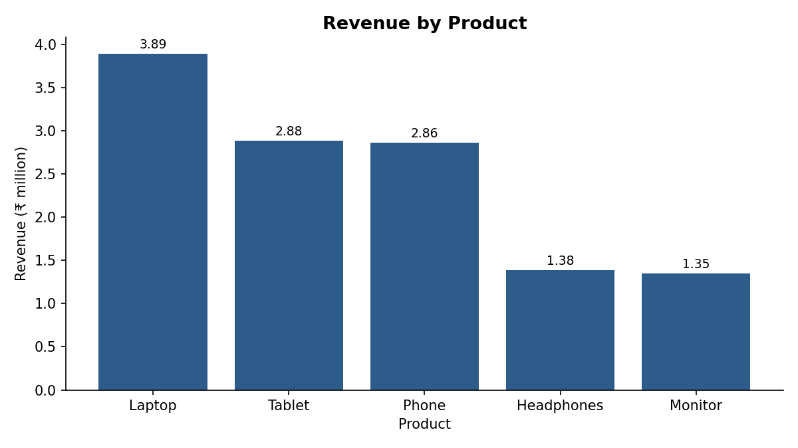
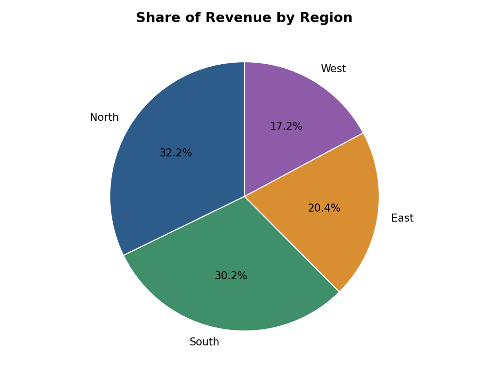
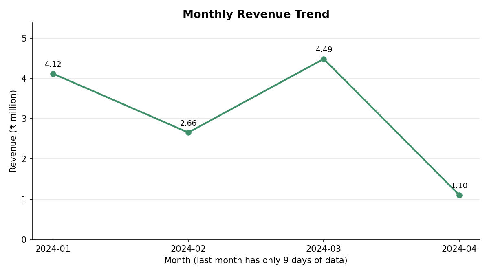
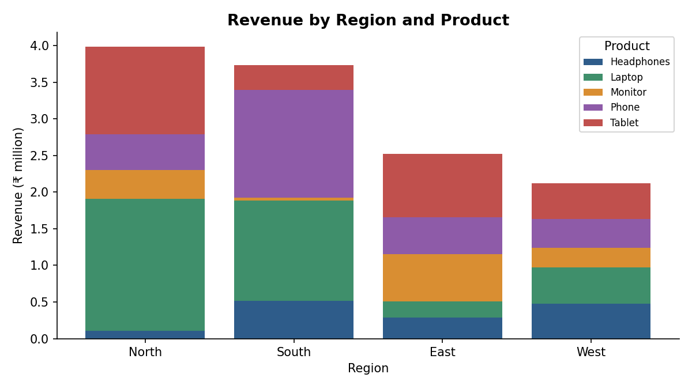

# E-commerce Sales Analysis Report

**Period:** 01 Jan 2024 to 09 Apr 2024  
**Orders analysed:** 100

## 1. Key Metrics

| Metric | Value |
|---|---|
| Total revenue | ₹12,365,048.00 |
| Total units sold | 478 |
| Average order value | ₹123,650.48 |
| Median order value | ₹97,955.50 |
| Largest order | ₹373,932.00 (Phone, South, 16 Jan 2024) |
| Smallest order | ₹6,540.00 (Tablet, North, 23 Feb 2024) |

## 2. Product Performance

| Product | Orders | Units | Revenue | Share |
|---|---|---|---|---|
| Laptop | 24 | 136 | ₹3,889,210.00 | 31.5% |
| Tablet | 26 | 127 | ₹2,884,340.00 | 23.3% |
| Phone | 20 | 101 | ₹2,859,394.00 | 23.1% |
| Headphones | 15 | 48 | ₹1,384,033.00 | 11.2% |
| Monitor | 15 | 66 | ₹1,348,071.00 | 10.9% |

## 3. Regional Performance

| Region | Orders | Revenue | Share |
|---|---|---|---|
| North | 28 | ₹3,983,635.00 | 32.2% |
| South | 27 | ₹3,737,852.00 | 30.2% |
| East | 19 | ₹2,519,639.00 | 20.4% |
| West | 26 | ₹2,123,922.00 | 17.2% |

## 4. Monthly Performance

| Month | Days with data | Revenue | Avg order value |
|---|---|---|---|
| 2024-01 | 31 | ₹4,120,524.00 | ₹132,920.13 |
| 2024-02 | 29 | ₹2,656,050.00 | ₹91,587.93 |
| 2024-03 | 31 | ₹4,485,006.00 | ₹144,677.61 |
| 2024-04 | 9 | ₹1,103,468.00 | ₹122,607.56 |

## 5. Visualizations

*Bar chart: revenue by product*

*Pie chart: share of revenue by region*

*Line chart: monthly revenue trend*

*Stacked bar chart: product mix inside each region*

## 6. Insights

1. **Laptop is the top product.** It earns ₹3,889,210.00 (31.5% of revenue) from 24 orders. Its lead comes from volume: customers buy 5.7 units per order, the highest of any product, not from a higher price (average price ₹27,651.50).
2. **Tablet gets the most orders** (26) but ranks #2 by revenue, so order count alone does not show which product earns the most.
3. **Monitor is the weakest product** at 10.9% of revenue. It is the best candidate for a promotion or bundle offer.
4. **North is the strongest region** (32.2%) and **West is the weakest** (17.2%). The gap is ₹1,859,713.00.
5. **2024-03 was the best month** with ₹4,485,006.00.
6. **2024-04 looks like a drop but is incomplete.** Data covers only 9 days of that month. Its average order value (₹122,607.56) is the fairer figure to compare.
7. **Order values vary a lot.** The largest order is about 57x the smallest, and the average (₹123,650.48) is above the median (₹97,955.50), so a few big orders pull the average up.

## 7. Recommendations

- Promote **Monitor** (bundles or discounts) to lift the weakest product line.
- Study what works in **North** and test it in **West**.
- Track order value as well as order count when judging products.
- Collect a full month of data before comparing the latest month.

## 8. Data Quality Summary

- Rows loaded: 100
- Missing values found: 0
- Duplicate rows removed: 0
- Rows dropped (missing key fields): 0
- Rows dropped (zero/negative quantity or price): 0
- Total_Sales values corrected: 0
- Rows used in analysis: 100
